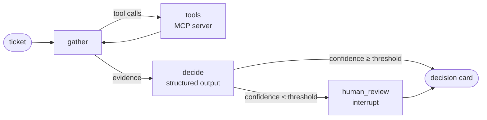

# LangGraph Triage Agent

A model-agnostic support-ticket triage agent built with **LangGraph**. It gathers evidence
through tools served by its own **MCP server**, returns a validated **structured decision
card**, pauses for **human review** when it is unsure, and ships with an **eval harness**
that compares LLM providers on a labelled ticket set.

Swap Claude, OpenAI, Gemini, Bedrock or a local Llama with one flag. The graph, tools,
prompts and evals stay the same.

## How it works



| Node | What it does |
|---|---|
| `gather` | The model calls tools (`lookup_customer`, `get_policy`, `check_service_status`) until it has the evidence, then summarises it. A round limit stops runaway loops. |
| `tools` | LangGraph `ToolNode` over tools loaded from the MCP server via `langchain-mcp-adapters` (stdio). |
| `decide` | A separate structured-output call turns the evidence into a `TriageDecision`: category, priority, action, owning team, confidence, rationale, policies applied and a draft reply. The evidence is passed as provider-neutral text, so every provider gets the same input. |
| `human_review` | LangGraph `interrupt()`: when confidence is below `TRIAGE_REVIEW_THRESHOLD`, the run pauses with a checkpoint until a person approves or overrides it, then resumes with `Command(resume=...)`. |

## Quick start

```bash
python -m venv .venv && source .venv/bin/activate
pip install -e ".[dev,anthropic]"        # or openai, google, bedrock, ollama, all
cp .env.example .env                     # add the API keys you have

triage --model claude --eval-id T06 --trace
triage --model openai --customer C-1001 --subject "Forgot password" --body "I'm locked out"
```

`T06` is a password-reset request from an account flagged for suspicious logins. The
policy says that is a possible compromise, not a routine reset, so a correct agent
escalates instead of sending a reset link.

## One model-agnostic layer

`src/triage_agent/llm.py` resolves an alias from `models.toml` (or any raw
`provider:model-id`) and builds the model with LangChain's `init_chat_model`. Structured
output uses each provider's most reliable mode (native JSON schema where supported).

```toml
[models]
claude  = "anthropic:claude-sonnet-5-5"
openai  = "openai:gpt-4o-mini"
gemini  = "google_genai:gemini-2.5-flash"
bedrock = "bedrock_converse:anthropic.claude-3-5-haiku-20241022-v1:0"
llama   = "ollama:llama3.1"
```

Model IDs change often, so edit `models.toml` or override one per run with an environment
variable: `TRIAGE_MODEL_OPENAI="openai:<model-id>"`.

## Tools over MCP

`src/triage_agent/mcp_server.py` is a standalone MCP server (`triage-mcp`, stdio). The
agent launches it as a subprocess, and any MCP client (Claude Desktop, Claude Code,
another agent) can use the same tools. Adding a data source such as a CRM or ticketing
system means adding a server entry in `tools.py`. The graph doesn't change.

## Evals: which model fits this use case?

`data/eval_tickets.jsonl` holds 30 labelled tickets covering refunds, double charges,
lockouts, flagged accounts, known incidents versus new outages, bugs, feature requests,
cancellations, security and GDPR requests. The labels follow `data/policies.json`.

```bash
python evals/run_evals.py --models claude claude-haiku openai gemini llama
python evals/run_evals.py --models claude --limit 5     # quick smoke run
```

The harness scores exact-match accuracy on category, priority and action (plus "all three
correct"), errors, mean latency and total tokens. It writes `evals/results.md` and
per-ticket JSONL to `evals/results/` for error analysis.

<!-- Paste the generated evals/results.md table here once you have run it. -->

## Tracing

Set `LANGSMITH_TRACING=true` and `LANGSMITH_API_KEY` in `.env`, and every run (the gather
loop, each tool call and the decision) shows up as a trace in LangSmith. No code changes
needed.

## Tests (offline, no API keys)

```bash
pytest
```

The tests replay scripted model responses, including tool calls, and cover:
- the tool loop
- the evidence passed to the decision step
- interrupt and resume, with both approval and override
- the tool-round limit
- running the graph against the **real MCP server over stdio**
- the eval labels themselves

## Project layout

```
src/triage_agent/
  llm.py          model-agnostic layer (init_chat_model + structured-output strategy)
  graph.py        the LangGraph state machine
  mcp_server.py   MCP server exposing the support tools
  tools.py        loads MCP tools as LangChain tools
  schemas.py      Ticket and TriageDecision (Pydantic)
  prompts.py      gather and decide prompts
  cli.py          `triage` command with interactive human review
evals/run_evals.py  model comparison harness
data/              customers, policies, service status, labelled eval tickets
models.toml        alias -> provider:model-id
```

## Design decisions

- **Two LLM steps, not one.** Gathering evidence with tools and making the final decision
  have different requirements: free-form tool use versus a strict schema. Splitting them
  keeps the decision call provider-neutral and gives the eval harness a single, typed
  output to score.
- **Policies live in data, not prompts.** The agent has to retrieve the policy that
  applies, which is closer to production and makes "did it look up the right policy?"
  visible in traces.
- **Human-in-the-loop on low confidence**, using LangGraph's checkpointed `interrupt`,
  so a paused run can resume later without rerunning the model calls.
